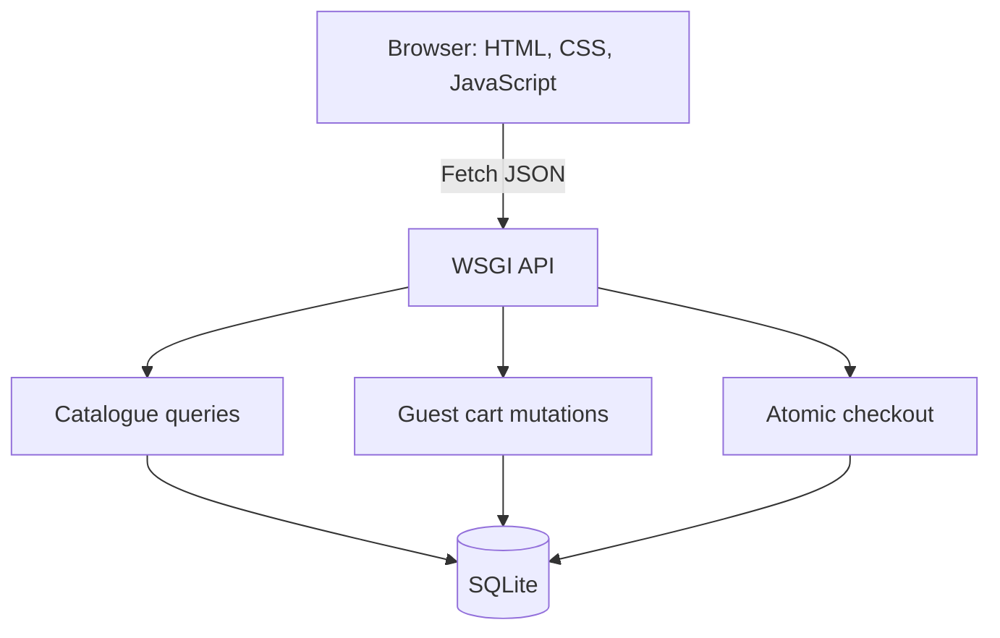
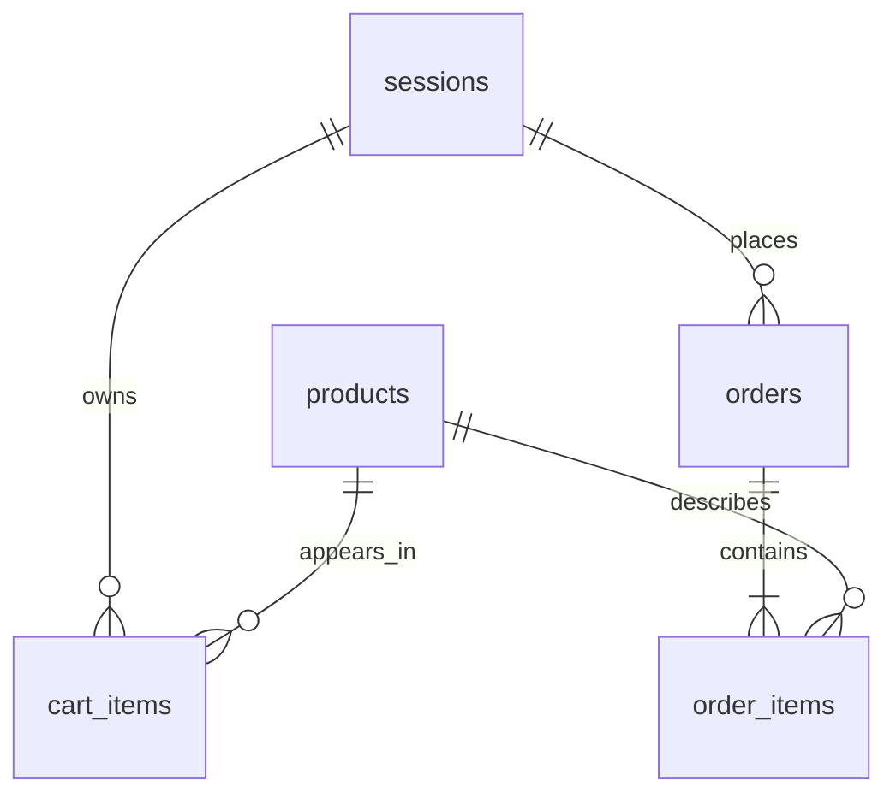

# Architecture and data design

The browser renders HTML in static/app.js. Same-origin Fetch sends JSON to the
Python WSGI API. Each request finds its guest session and accesses SQLite through db.py.

| Entity | Fields |
| --- | --- |
| products | id PK, title, author, category, description, price_cents, stock, image |
| sessions | id PK (cookie token hash), csrf, created_at |
| cart_items | session_id PK/FK, product_id PK/FK, quantity |
| orders | id PK, session_id FK, idempotency_key, customer_name, email, address, city, postal_code, total_cents, created_at |
| order_items | order_id PK/FK, product_id PK/FK, title snapshot, unit_price_cents snapshot, quantity |

Orders and products are many-to-many through order_items. Item snapshots preserve
purchase details after catalogue changes. UNIQUE(session_id,idempotency_key) protects retries.

| Page transition | Data passed | Source of truth |
| --- | --- | --- |
| Catalogue to detail | Product ID in hash route | SQLite product |
| Detail to cart | Product ID/quantity JSON, CSRF header | Session and stock |
| Edit cart | Product ID/new quantity | Guest cart row |
| Cart to checkout | Session cookie, refreshed cart JSON | Database prices |
| Checkout to confirmation | Customer fields, demo acknowledgment, key | Stored order/items |
| Reload confirmation | Order ID and owning cookie | Session-restricted query |

| Wireframe | Desktop | Mobile |
| --- | --- | --- |
| Catalogue | Header, hero, search/filter/sort, four-column grid | Stacked hero, two-column grid |
| Detail | Cover left, price/text/add form right | Cover above information |
| Cart | Editable rows left, summary right | Rows above summary |
| Checkout | Labelled form left, summary right | Single-column fields |
| Confirmation | ID, demo notice, customer, item totals | Stacked customer/address |

Parameterized SQL protects queries. CSRF guards mutations. HttpOnly/SameSite cookies
identify sessions. Text escapes before insertion into HTML. A same-origin CSP limits
resources. Checkout uses BEGIN IMMEDIATE and rollback on failure. Client prices are
ignored, and order access requires ownership. These are prototype safeguards.
